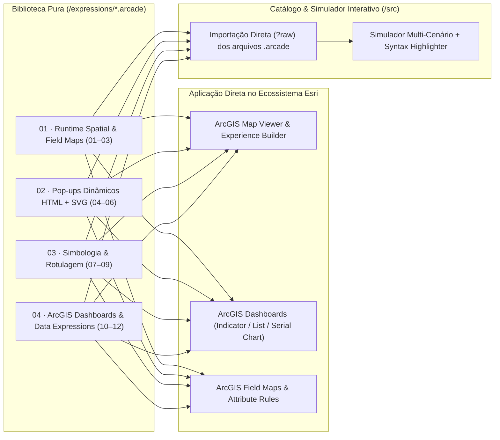

# ArcGIS Arcade Toolkit — Expressões Reutilizáveis & Catálogo Interativo

Biblioteca técnica de expressões **ArcGIS Arcade** prontas para produção e **simulador visual interativo**, desenvolvida para apoiar plataformas de monitoramento territorial, licenciamento ambiental, recursos hídricos, transição energética e salas de situação em **ArcGIS Online**, **ArcGIS Dashboards**, **Experience Builder**, **Field Maps** e **ArcGIS Pro**.

[](https://gemendesc.github.io/arcgis-arcade-toolkit/)


---

## 1. Propósito e Diferenciais de Engenharia

Projetos institucionais no ecossistema Esri frequentemente enfrentam dois gargalos opostos: (1) bancos geográficos sobrecarregados com dezenas de colunas estáticas criadas apenas para formatar rótulos, semáforos de vencimento ou pop-ups; ou (2) expressões Arcade escritas sem cuidado algorítmico (uso de geometria planar em `EPSG:3857` ou *queries* `N+1` dentro de laços `for`), travando painéis executivos.

Este repositório reúne **12 expressões modulares (`.arcade`)** construídas sobre quatro princípios:

1. **Geodésia Estrita no Território Brasileiro:** Uso exclusivo de `AreaGeodetic()`, `BufferGeodetic()` e `DistanceGeodetic()`, evitando erros planares de `+13%` a `+38%` causados pela projeção *Web Mercator* nas latitudes brasileiras;
2. **Pushdown SQL e *Hash Join* em Memória (`O(N + M)`):** Pré-filtragem com `Filter()` e agregação `GroupBy()` no servidor antes de cruzar camadas independentes em *Data Expressions*;
3. **HTML/SVG Sanitizado e Higiene de Nulos:** Cards editoriais e mini-gráficos em SVG vetorial inline compatíveis com o sanitizador de *ArcGIS Map Viewer / Experience Builder*, omitindo automaticamente atributos vazios;
4. **Simulador Interativo sem Dependência de Login AGOL:** Aplicação web acoplada ao repositório que consome diretamente os arquivos `.arcade` e simula a saída visual de cada perfil (*Pop-up*, *Field Maps*, *Matriz Bivariada 3×3*, *Indicator KPI*, *List* e *FeatureSet* virtual).

---

## 2. Arquitetura do Toolkit



---

## 3. Catálogo das 12 Expressões Reutilizáveis

| # | Expressão (`.arcade`) | Perfil Principal | Caso de Uso Técnico |
| :-: | :--- | :--- | :--- |
| **01** | [`01-sobreposicao-uc-ti.arcade`](expressions/runtime-spatial/01-sobreposicao-uc-ti.arcade) | `Popup` · `Attribute Rule` | Interseção geodésica sob demanda com **Terras Indígenas (FUNAI)** e **Unidades de Conservação (ICMBio)**, calculando hectares e `%` sobreposto. |
| **02** | [`02-conformidade-app-hidrografia.arcade`](expressions/runtime-spatial/02-conformidade-app-hidrografia.arcade) | `Popup` · `Field Maps` | Busca cursos d'água em raio de `600 m` e confronta a distância geodésica medida com a faixa marginal legal de **APP (Lei nº 12.651/2012, Art. 4º)**. |
| **03** | [`03-autopreenchimento-campo-ottobacias.arcade`](expressions/runtime-spatial/03-autopreenchimento-campo-ottobacias.arcade) | `Field Maps` · `Attribute Rule` | Autopreenchimento de **Município/UF (IBGE)**, **Ottobacia Nível 5 (ANA)** e conversão trigonométrica para coordenadas **GMS** em coletas de campo. |
| **04** | [`04-ficha-executiva-socioambiental.arcade`](expressions/popups/04-ficha-executiva-socioambiental.arcade) | `Popup Element (HTML)` | Ficha técnica responsiva codificada por grau de risco com **omissão automática de linhas nulas/vazias**. |
| **05** | [`05-sparkline-svg-desmatamento-prodes.arcade`](expressions/popups/05-sparkline-svg-desmatamento-prodes.arcade) | `Popup Element (HTML/SVG)` | Gráfico de colunas em **SVG puro** (`2019–2024`) + barra empilhada de cobertura vegetal (**PRODES / MapBiomas**) sem lentidão de gráficos nativos. |
| **06** | [`06-central-links-contextuais-webgis.arcade`](expressions/popups/06-central-links-contextuais-webgis.arcade) | `Popup Element (HTML)` | Botões de ação com *deep links* parametrizados para **Experience Builder (`#data_s=...`)**, **Google Earth 3D** e **IBGE Cidades**. |
| **07** | [`07-matriz-bivariada-pressao-hidrica.arcade`](expressions/symbology-labeling/07-matriz-bivariada-pressao-hidrica.arcade) | `Visualization (Symbology)` | Classificação multicritério **bivariada 3×3 (`A1`–`C3`)** cruzando conversão antrópica do solo (`%`) × comprometimento hídrico da `Q95` (ANA). |
| **08** | [`08-semaforo-vigencia-licencas-outorgas.arcade`](expressions/symbology-labeling/08-semaforo-vigencia-licencas-outorgas.arcade) | `Visualization` · `Popup` | Controle diário de vencimento de licenças/outorgas contra `Now()`, incluindo a prorrogação automática de `120 dias` da **CONAMA nº 237/1997 (Art. 18 §4º)**. |
| **09** | [`09-rotulos-adaptativos-escala.arcade`](expressions/symbology-labeling/09-rotulos-adaptativos-escala.arcade) | `Labeling` | Generalização cartográfica progressiva guiada por `$view.scale` (sigla macro → nome + grupo SNUC → bloco técnico multilinha). |
| **10** | [`10-data-expression-ranking-bacias-uf.arcade`](expressions/dashboards/10-data-expression-ranking-bacias-uf.arcade) | `Dashboards Data Expression` | Consolidação `GroupBy()` + *Hash Join* `O(N+M)` de duas camadas independentes em um `FeatureSet` virtual ordenado por índice de pressão. |
| **11** | [`11-indicador-kpi-variacao-anual-yoy.arcade`](expressions/dashboards/11-indicador-kpi-variacao-anual-yoy.arcade) | `Dashboards Indicator` | KPI executivo comparando ciclo atual (`$datapoint`) vs. homólogo (`$reference`) e meta anual máxima, com setas `▲/▼` e cores condicionais. |
| **12** | [`12-lista-avancada-cards-monitoramento.arcade`](expressions/dashboards/12-lista-avancada-cards-monitoramento.arcade) | `Dashboards List` | Formatação avançada de cards ranqueados com barra proporcional ao máximo da seleção (`$reference`) e pílulas de prioridade `P1/P2/P3`. |

---

## 4. Estrutura do Repositório

```text
arcgis-arcade-toolkit/
├── docs/
│   └── boas-praticas-performance.md      # Guia de pushdown SQL, geodésia e decisão Arcade vs. PostGIS
├── expressions/                          # Expressões puras .arcade (Single Source of Truth)
│   ├── runtime-spatial/                  # Interseções geodésicas, APP e Field Maps (01 a 03)
│   ├── popups/                           # Cards HTML responsivos, SVG inline e Deep Links (04 a 06)
│   ├── symbology-labeling/               # Matriz bivariada 3x3, CONAMA 237/97 e $view.scale (07 a 09)
│   └── dashboards/                       # Data Expressions, KPIs YoY e List Cards (10 a 12)
├── sample-data/
│   └── ativos-monitoramento-amostra.geojson # Massa de dados WGS84/SIRGAS pronta para ArcGIS Online
└── src/                                  # Catálogo interativo e simulador visual (React + TypeScript)
```

---

## 5. Como Testar Rapidamente

### Opção 1 — Executar o Catálogo e Simulador Interativo Localmente

```bash
npm install
npm run dev
```

Para gerar o bundle estático de produção (`dist/`):

```bash
npm run build
```

### Opção 2 — Testar Diretamente no ArcGIS Online / Location Platform

1. Acesse sua conta no **ArcGIS Online** (ou conta gratuita *ArcGIS Location Platform*) e publique o arquivo [`sample-data/ativos-monitoramento-amostra.geojson`](sample-data/ativos-monitoramento-amostra.geojson) como uma *Hosted Feature Layer*;
2. Abra a camada no **Map Viewer**, adicione um elemento *Arcade* no painel de **Pop-ups** ou **Styles** e cole qualquer expressão de `/expressions/popups/` ou `/expressions/symbology-labeling/`;
3. Para expressões que consultam camadas externas (`FeatureSetByPortalItem`), substitua o `Item ID` exemplificado pelo identificador da camada oficial da sua organização.

Consulte também o guia completo em **[`docs/boas-praticas-performance.md`](docs/boas-praticas-performance.md)**.

---

## Autor

**George Mendes** — Engenheiro Ambiental e Sanitarista · Especialista em Geotecnologias e Desenvolvimento WebGIS  
[Portfólio (georgemendes.net)](https://georgemendes.net/) · [LinkedIn](https://www.linkedin.com/in/gemendesc) · [GitHub (@gemendesc)](https://github.com/gemendesc)
